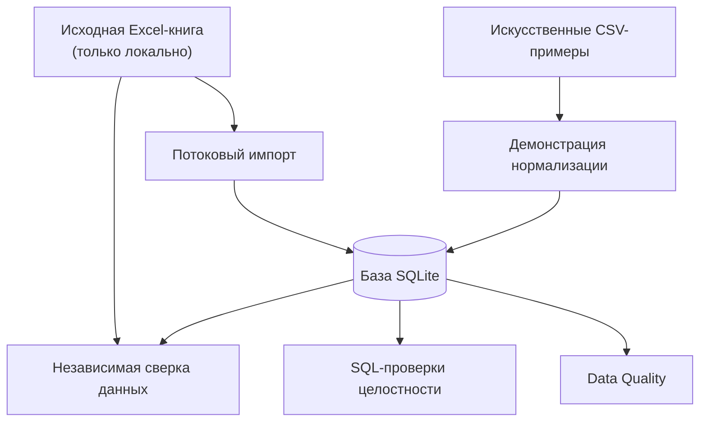

# 🌍 Географический справочник для DWH

### Master Data Management · Data Quality · Python · SQL · SQLite

**Воспроизводимый проект по переносу географического справочника из Excel в реляционную базу, нормализации внешних идентификаторов и автоматической проверке качества данных.**

[](https://github.com/Aeternym/geography-master-data/actions/workflows/ci.yml)


> **Основная идея:** одно название города ещё не означает один и тот же географический объект. Надёжному справочнику нужны стабильные идентификаторы, связи между сущностями, история изменений и правила обработки конфликтующих данных.

## 📊 Проект в цифрах

| Показатель | Подтверждённый результат |
|---|---:|
| Страны | **249** |
| Регионы | **5 046** |
| Населённые пункты | **162 189** |
| Импортированные таблицы | **12** |
| Строки во всех таблицах | **664 391** |
| Проверенные значения с ведущими нулями | **41 877** |
| Автоматические тесты | **29** |
| Нарушения внешних ключей после переноса | **0** |

Это проверенные характеристики **закрытой исходной Excel-книги**, использованной в учебно-практическом проекте. Полные данные в репозитории отсутствуют: публичная демонстрация работает только с искусственно созданными примерами.

## 🎯 Какую задачу решает проект

Данные о странах, регионах и населённых пунктах поступают из разных источников и не всегда согласуются между собой:

- у разных населённых пунктов бывают одинаковые названия;
- один объект может иметь несколько названий и вариантов написания;
- идентификаторы ФИАС/ГАР, ОКАТО и ОКТМО не всегда однозначно сопоставляются;
- административные связи и атрибуты меняются во времени;
- часть входных значений нельзя уверенно сопоставить с каноническим справочником.

Поэтому задача не сводится к созданию одной таблицы городов. Требуется модель **Master Data Management (MDM)** с явными правилами идентификации, историчностью и контролем качества данных.

## 🧩 Что реализовано

### 1. Каноническая модель

Три основные сущности:

- `geo_country` — страны;
- `geo_region` — регионы;
- `geo_locality` — населённые пункты.

У объектов есть стабильные `country_id`, `region_id` и `locality_id`. Изменение названия или других атрибутов не должно приводить к произвольной смене идентификатора.

### 2. Сопоставление внешних кодов

Таблица `locality_external_ids` хранит связи канонических объектов с внешними классификаторами и источниками.

Коды ОКАТО, ОКТМО и другие идентификаторы хранятся как **текст**, поэтому при импорте не теряются ведущие нули.

### 3. Консервативная нормализация

Алгоритм сравнивает предоставленные идентификаторы и географические признаки, прежде чем назначить канонический объект.

| Статус | Значение |
|---|---|
| `matched` | Найдено единственное подтверждённое совпадение |
| `ambiguous` | Осталось несколько допустимых кандидатов |
| `unresolved` | Подтверждённое совпадение не найдено |
| `source_conflict` | Источники или идентификаторы противоречат друг другу |

**Принцип:** разные FIAS GUID нельзя объединять только из-за одинаковых названий. Если, например, GUID и ОКТМО указывают на разные объекты, результатом будет конфликт, а не ложное совпадение.

### 4. История и карантин

Исторические таблицы сохраняют версии объектов и периоды их действия. Неоднозначные входные значения и записи с конфликтами не подменяются «удобными» совпадениями и могут оставаться на дополнительную проверку.

### 5. Автоматический контроль качества

Реализованы проверки:

- первичных и внешних ключей;
- связей «страна → регион → населённый пункт»;
- форматов внешних кодов;
- статусов нормализации;
- конфликтующих сопоставлений;
- исторических версий;
- отсутствующих регионов и часовых поясов;
- карантина и проблемных записей.

## 🏗️ Архитектура



Два режима используют общую модель данных:

- **private/full** — импорт полной исходной книги и проверка переноса;
- **public/demo** — небольшой воспроизводимый пример без корпоративных данных.

## 🚀 Как запустить проект

Понадобится **Python 3.11+**. Исходный Excel, доступ к корпоративным системам и загрузка внешних справочников **не требуются**.

### 1. Клонировать репозиторий

```bash
git clone https://github.com/Aeternym/geography-master-data.git
cd geography-master-data
```

### 2. Создать виртуальное окружение

```bash
python -m venv .venv
```

Активация в Windows:

```powershell
.venv\Scripts\activate
```

Активация в Linux/macOS:

```bash
source .venv/bin/activate
```

Установить проект:

```bash
python -m pip install -e .
```

### 3. Создать демонстрационную базу

```bash
python -m geo_reference.cli demo --output data/output/demo.db
```

### 4. Запустить проверки качества

```bash
python -m geo_reference.cli validate --database data/output/demo.db
python -m geo_reference.cli sql-checks --database data/output/demo.db
```

### 5. Запустить тесты

```bash
python -m unittest discover -s tests -v
```

Демонстрационные сценарии покрывают совпадения по коду и названию, альтернативные названия, неоднозначности, конфликты FIAS GUID/ОКТМО и неизвестные значения.

**`PASS` означает, что пройдены реализованные проверки на демонстрационном наборе, а не что доказано соответствие всем возможным бизнес-требованиям.**

## 🔄 Как проверяется перенос Excel → SQLite

Импортёр читает большую Excel-книгу потоково, сохраняет идентификаторы, историю, внешние коды и исходные статусы нормализации.

Перед заменой существующей базы программа:

1. Проверяет входной и выходной пути.
2. Создаёт временную SQLite-базу.
3. Проверяет структуру, ограничения и внешние ключи.
4. Независимо сравнивает содержимое Excel и SQLite.
5. Заменяет целевой файл только после успешной проверки.

Предусмотрена защита от случайной перезаписи исходного Excel через одинаковые пути, символические и жёсткие ссылки, а также через опасные расширения выходного файла.

Для собственной книги, которую разрешено обрабатывать локально:

```bash
python -m geo_reference.cli import-excel --input path/to/source.xlsx --output data/private/full.db
python -m geo_reference.cli verify-parity --input path/to/source.xlsx --database data/private/full.db
```

Полная база и исходный Excel **не должны добавляться в Git**.

## ✅ Что удалось проверить

При независимом повторном переносе исходной книги:

| Проверка | Результат |
|---|---|
| Совпадение количества строк | ✅ 12/12 таблиц |
| Совпадение нормализованного содержимого и хешей | ✅ PASS |
| Сохранение стабильных идентификаторов | ✅ PASS |
| Сохранение ведущих нулей | ✅ PASS |
| Нарушения внешних ключей | ✅ 0 |
| Несоответствия страны и региона | ✅ 0 |
| Python-тесты в Linux-окружении | ✅ 29/29 |

Тесты также проверяют отказоустойчивость импорта: повреждённый Excel, конфликт идентификаторов, попытки перезаписи исходного файла и сохранение предыдущей базы при неуспешной проверке.

## ⚠️ Известные ограничения

**Корректный перенос не означает готовность исходного справочника к промышленной эксплуатации.**

В исходных данных остаются нерешённые вопросы:

| Проблема | Количество |
|---|---:|
| Населённые пункты без `region_id` | 550 |
| Населённые пункты без часового пояса | 1 948 |
| Регионы без часового пояса | 555 |
| Группы карантина для дополнительной проверки | 6 |

Эти ограничения зафиксированы, но не исправлены произвольным назначением регионов или автоматическим слиянием объектов.

Проект воспроизводит **импорт итоговой Excel-книги**, а не полный исходный ETL из первичных наборов ФИАС/ГАР, ISO, ОКАТО, ОКТМО и других классификаторов.

## 📁 Структура репозитория

```text
geography-master-data/
├── .github/workflows/   # Проверки GitHub Actions
├── docs/                # Архитектура и методология
├── examples/            # Синтетические данные
├── sql/                 # Схема, индексы, SQL-проверки
├── src/geo_reference/   # Код Python
├── tests/               # Автоматические тесты
├── pyproject.toml
└── README.md
```

### Техническая документация

- [Архитектура](docs/architecture.md)
- [Модель данных](docs/data_model.md)
- [Правила нормализации](docs/normalization_rules.md)
- [Контроль качества](docs/data_quality.md)
- [Ограничения](docs/limitations.md)
- [Источники и права использования](docs/provenance_and_licenses.md)

*Подробные технические документы пока представлены на английском языке.*

## 🔐 Что не публикуется

В публичном репозитории нет:

- оригинальной корпоративной Excel-книги;
- полной базы SQLite;
- реальных сопоставлений из внутренних систем;
- внутренних бизнес-документов;
- подробных записей карантина;
- корпоративных токенов и учётных данных.

Все доступные для запуска примеры созданы специально для демонстрации.

## Как применял AI в публичном прототипе

При подготовке технической версии для портфолио использовал Claude и Codex для декомпозиции задачи, проработки вариантов реализации и подготовки кода и тестов. Проверка результата опирается на воспроизводимые команды CLI, SQL-проверки и 29 автоматических тестов.

Сопоставление географических объектов при запуске выполняют детерминированные правила Python/SQL, а не запросы к языковой модели. AI помогал в разработке прототипа, но не заменял контроль корректности данных.

## 👨‍💻 О происхождении проекта

Исходный географический справочник я разрабатывал и анализировал **как учебное задание, полученное во время работы**. Компания не использовала эту работу в своих системах; промышленного внедрения не было.

Python/SQL-инструменты, синтетические примеры, тесты и GitHub Actions были подготовлены позднее для технического портфолио **с активным применением AI-инструментов**, проверкой кода и воспроизводимыми испытаниями.

Проект демонстрирует навыки:

`Business Analysis` · `Master Data Management` · `Data Quality` · `Data Modeling` · `Python` · `SQL` · `SQLite` · `Data Governance` · `Acceptance Testing`

Это **технический портфельный проект**, а не заявление о внедрении промышленной DWH-системы.

---

**Другие проекты:** [GitHub Aeternym](https://github.com/Aeternym) · [Портфолио бизнес-аналитика](https://github.com/Aeternym/business-analyst-portfolio)
